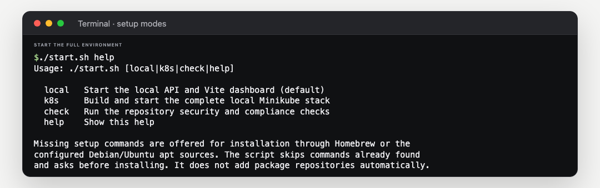
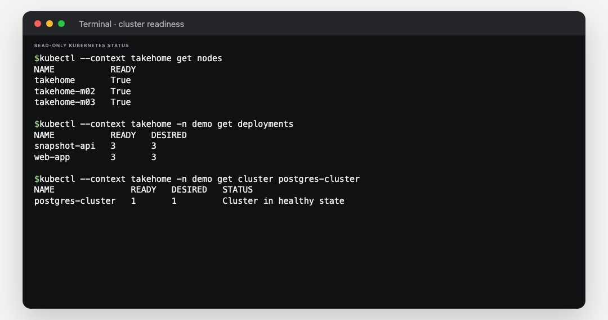

# Run the Kubernetes environment

## Before you start

The script checks for Docker, `kubectl`, Minikube, Helm 4+, Bun 1.3.14+, OpenSSL, Python 3, and `lsof`. It reuses installed tools that meet these requirements and asks before installing missing tools or upgrading Bun and Helm. It uses Homebrew on macOS or apt sources already configured on Debian or Ubuntu; it does not add package repositories. If Docker Desktop is stopped, it asks before opening it.

Start Docker Desktop's Linux engine when prompted. Use Bash on macOS, Linux, or WSL2. If a required tool is not available from the existing package sources, the script names it and stops before setup.

## Start

1. Unzip the project and open Terminal in its folder. Confirm `start.sh` is there:

   ```bash
   ls start.sh bun.lock
   ```

2. Start the complete cluster:

   ```bash
   ./start.sh k8s
   ```

   If needed, use `bash ./start.sh k8s`. Keep this terminal open while using the dashboard. The first run builds images and installs cluster components, so it can take several minutes.



## Open and stop

When setup finishes, open `https://takehome.localhost:8443`. Keep the terminal open for the connection. If the browser reports `ERR_CERT_AUTHORITY_INVALID`, trust the local CA at the path printed by the script, then reload. The hostname routes locally but does not make the certificate trusted.

For Logs, select `k8s/overlays/local/log-access-token`. Keep this shared token private; use it only after trusted HTTPS is working.

Press **Ctrl+C** in the setup terminal to stop the connection. To stop Minikube too, run `minikube stop -p takehome` in another terminal.

## Check readiness

Run these read-only commands after setup:

```bash
kubectl --context takehome get nodes
kubectl --context takehome -n demo get deployments
kubectl --context takehome -n demo get cluster postgres-cluster
```


